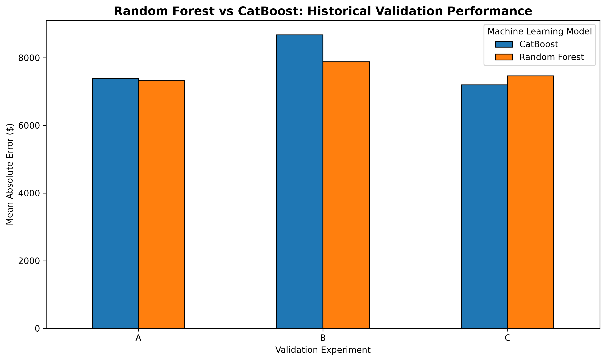
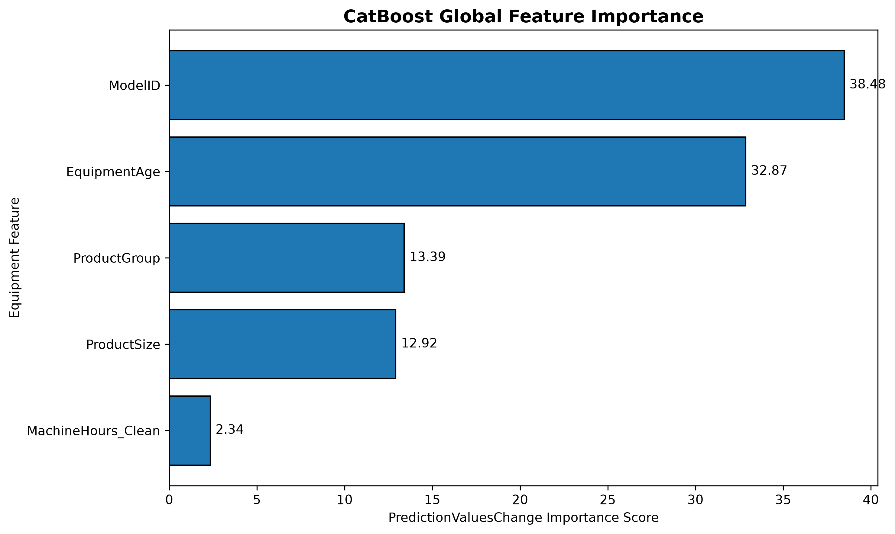

# Used Heavy Equipment Price Prediction & Market Intelligence

**Python · Machine Learning · CatBoost · Random Forest · Time-Series Validation · SHAP**

## Business question

Can historical auction records provide useful estimates of used heavy equipment selling prices, and where do these estimates become unreliable?

This independent portfolio case study applies a reproducible regression workflow to the **Kaggle Blue Book for Bulldozers** dataset. It is not commissioned work for an auction company.

## Dataset and setup

The original `Train.csv` contains **401,125 transactions and 53 columns**, covering **1989–2011**.

The raw dataset is **not redistributed in this repository**. Obtain `Train.csv` from the Blue Book for Bulldozers Kaggle competition (subject to its terms) and place it at `data/raw/Train.csv`.

```bash
python -m venv .venv

# Activate .venv using instructions for your operating system

pip install -r requirements.txt

python -m pytest -q

jupyter lab
```

Start Jupyter from the repository root, or open the notebooks from the `notebooks/` directory.

Execute the notebooks in order:

1. `01_exploratory_data_analysis.ipynb`
2. `02_data_preparation.ipynb`
3. `03_model_development.ipynb`
4. `04_model_evaluation.ipynb`
5. `05_model_interpretability.ipynb`

**Model development fits six relatively expensive models.** You can run EDA and data preparation first and postpone the expensive fits.

## Data preparation

- Interpret `YearMade == 1000` and manufacturing years after sale as invalid.
- Define `EquipmentAge = SaleYear − YearMade_Clean`, preserving missing values.
- Retain zero operating hours as different from missing hours; invalidate readings that exceed an age-based physical limit when age is known.
- Treat `ModelID` as a **categorical identifier** rather than a continuous numerical feature.
- Use `EquipmentAge`, `MachineHours_Clean`, `ProductGroup`, `ModelID`, and `ProductSize` for the two final benchmarks.

## Historical validation design

| Experiment | Train | Validation |
|---|---|---|
| A | 2001–2005 | 2006–2007 |
| B | 2003–2007 | 2008–2009 |
| C | 2005–2009 | 2010–2011 |

Random Forest fits imputation and one-hot encoding on each **training** fold only.

CatBoost handles missing numerical predictors and explicitly labeled missing categorical values.

The models were selected through repeated development-stage comparisons.

## Reproduced development-validation results (locally verified, November 2026)

The notebook `03_model_development.ipynb` was executed against the 401,125-row source data in the analyst's local environment:

- Python 3.14.8
- pandas 3.0.6
- scikit-learn 1.9.1
- CatBoost 1.2.10

Its output was checked in `04_model_evaluation.ipynb`.

These are **development-validation results, not independent test results**.

| Validation window | Random Forest MAE | CatBoost MAE |
|---|---:|---:|
| A — 2006–2007 | **$7,316.82** | $7,386.08 |
| B — 2008–2009 | **$7,879.70** | $8,676.73 |
| C — 2010–2011 | $7,464.70 | **$7,200.14** |
| **Unweighted mean across the three periods** | **$7,553.74** | **$7,754.32** |

The three-period mean gives equal weight to each period, **not** each transaction.

Random Forest has the lower mean MAE in this reproduction, while CatBoost leads in the 2010–2011 window.

Neither model can be declared superior on truly unseen future transactions from these experiments alone.

### Model performance visualization

The following chart compares Random Forest and CatBoost across the three historical validation periods.

**Lower MAE indicates better predictive accuracy.**



**Key observation:** Random Forest achieved lower prediction errors in experiments A and B, while CatBoost performed better in experiment C.

This variation highlights the importance of evaluating models across different historical periods rather than relying on a single validation result.

### Additional CatBoost evaluation results

For CatBoost in 2010–2011:

| Metric | Result |
|---|---:|
| Mean Absolute Error | $7,200.14 |
| Median Absolute Error | $4,189.99 |
| Mean Absolute Percentage Error | 23.87% |
| Predictions with absolute error exceeding $10,000 | 22.08% |

These results show that the model provides useful historical price estimates but can produce substantial errors for individual transactions.

## Model interpretability

To better understand the CatBoost model, we examined global feature importance and local SHAP explanations.

### CatBoost global feature importance

The following chart presents CatBoost's global feature importance using the `PredictionValuesChange` measure.



| Feature | Importance Score |
|---|---:|
| ModelID | 38.48 |
| EquipmentAge | 32.87 |
| ProductGroup | 13.39 |
| ProductSize | 12.92 |
| MachineHours_Clean | 2.34 |

**Interpretation:** ModelID and EquipmentAge received the highest importance scores in the fitted CatBoost model.

These scores reflect model attribution, **not variance explained or causal effects**.

### Local SHAP explanation

We also examined how individual equipment characteristics contributed to a selected prediction.

For one validation record, the SHAP contributions reconstructed the CatBoost prediction:

| Component | Value |
|---|---:|
| Reference prediction | $32,023.55 |
| Model prediction | $26,042.16 |

The analysis demonstrated how individual equipment characteristics increased or decreased the predicted selling price relative to the model's reference value.

SHAP explanations describe the model's prediction process; they do not establish the causes of actual auction prices.

## Historical benchmark discrepancy

The earlier research notebook reported Random Forest MAEs of **$7,539.81 / $8,151.64 / $7,639.24** for periods A/B/C, with a mean of **$7,776.90**.

The reorganized project's Random Forest results differ, whereas its CatBoost values match the historical results to two decimals.

This difference is **unresolved**.

The new Random Forest pipeline fits preprocessing within each training fold. Changes in feature handling and library versions are plausible explanations, **not verified causes**.

Do not describe this discrepancy as a demonstrated model improvement.

See [`reports/TECHNICAL_AUDIT.md`](reports/TECHNICAL_AUDIT.md).

All metrics should be computed from model predictions.

The modelling notebook generates:

- `reports/tables/walkforward_recomputed.csv`
- `reports/tables/model_comparison_recomputed.csv`
- `reports/tables/catboost_2010_2011_predictions.csv`

The two summary CSV files are included in the repository. Transaction-level predictions are retained locally and excluded from Git tracking.

## Insights and business implications

- **Category-specific pricing:** The overall historical median selling price was **$24,000**, but category medians ranged from **$10,000 (SSL)** to **$40,000 (MG)**.
- **Price heterogeneity:** Selling prices were positively skewed, making a single overall price inadequate for valuing individual equipment models.
- **Equipment age:** EquipmentAge had an overall Pearson correlation of approximately **−0.248** with selling price, with stronger negative associations within some equipment categories.
- **Missing information:** `MachineHoursCurrentMeter` was missing in approximately **64.4%** of training records, while `ProductSize` was missing in approximately **52.6%**.
- **Category-specific missingness:** `ProductSize` was entirely missing in BL, MG, and SSL categories.
- **Prediction risk:** Historical price shifts and extreme individual errors demonstrate the importance of monitoring prediction bias and uncertainty, not only average prediction error.

## Repository structure

```text
notebooks/        # EDA, preparation, modelling, evaluation, interpretability
src/              # Reusable preprocessing, modelling, evaluation and path utilities
tests/            # Automated tests using synthetic data
reports/
    figures/      # Model comparison and feature importance visualizations
    tables/       # Recomputed model performance summaries
data/raw/         # User-provided Kaggle CSV (ignored by Git)
models/           # Optional locally fitted models (ignored by Git)
```

## Model limitations and integrity

Historical periods and the 2012 validation records were already consulted during feature development and model selection.

Neither provides an untouched independent estimate of deployment performance.

Additional limitations include:

- Historical prices are nominal and have not been adjusted for inflation.
- Equipment information completeness varies substantially across categories.
- Some transactions have large prediction errors.
- Feature importance and SHAP do **not** establish causality.
- The models have not been independently validated on genuinely unseen future transactions.

An independent future holdout is required before claiming generalizable predictive accuracy.

## Reproducibility status

**Execution reported and outputs reviewed:** The analyst executed the 401,125-row preparation workflow, all six walk-forward model fits, evaluation diagnostics, and CatBoost interpretability in a local Windows/Jupyter environment.

The associated output tables and screenshots were reviewed.

Both pytest tests passed locally after introducing a pandas dtype-compatible assertion.

EDA statistical outputs were also reviewed, although an independently inspected fresh-kernel full run has not been performed in this package.

Full model fits have **not** been independently rerun by the package author; published scores should be attributed to the analyst's reproduced local outputs.

See the technical audit for the unresolved Random Forest discrepancy.